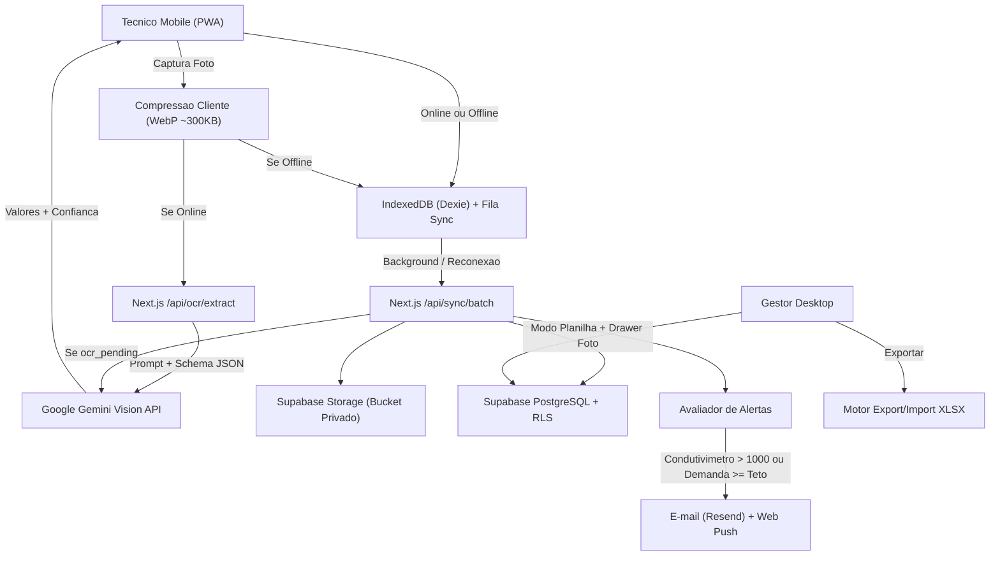

# SPEC.md — Sistema de Medições Diárias (Modo Planilha + Modo Campo com OCR)

> **Versão:** 1.0  
> **Data:** 2026-11-15  
> **Base de Origem:** Planilha `Medições_Diarias_Rev08.xlsx` (abas `2025` com 79 colunas / 365 dias e `2026` com 91 colunas)  
> **Stack Alvo:** Next.js (App Router, TypeScript) PWA + Supabase (PostgreSQL, Auth, Storage, RLS) + Google Gemini Vision API + Vercel

---

## 1. Visão Geral e Objetivos

Substituir a planilha manual `Medições_Diarias_Rev08.xlsx` por um sistema web progressivo (**PWA**) com **dois modos especializados** sobre uma única fonte oficial de dados:

1. **Modo Campo (Mobile / Offline-first):** interface focada exclusivamente nos **campos de entrada bruta** que o técnico precisa ler em campo. Oculta todas as colunas calculadas/fórmulas, permite capturar fotos dos medidores/painéis com extração via **OCR (Gemini Vision)**, armazena fotos e leituras localmente quando não houver sinal (subsolos, BSS, CAG) e sincroniza em lote ao reconectar.
2. **Modo Planilha (Desktop / Gestão):** grade interativa estilo Excel com coluna de data congelada, agrupamento por sistemas, cálculos automáticos determinísticos (bloqueados contra sobrescrita manual), filtros por período, comparação mensal e ano a ano sem erros `#REF!`, painel resumo com KPIs e gaveta lateral para inspeção de foto, confiança do OCR, revisão de pendências e histórico de auditoria.

### Princípios Arquiteturais
* **Separação rigorosa Input vs. Fórmula:** apenas entradas operacionais vão para o formulário de campo; deltas, médias, somatórios e percentuais são calculados automaticamente pelo motor do sistema.
* **Modelo normalizado e catálogo dinâmico:** em vez de uma tabela rígida de 91+ colunas, o banco armazena leituras em formato normalizado (`data + medidor`), permitindo ativar/desativar seções (ex.: Chillers 1 e 2) e cadastrar novos medidores/lojas sem migrações destrutivas nem quebra do histórico.
* **Rastreabilidade total:** toda leitura mantém referência às fotos originais, score de confiança do OCR, status de revisão e log imutável de quem lançou ou corrigiu.

---

## 2. Requisitos Fechados (Decisões de Projeto)

| Tema | Decisão Definida |
| :--- | :--- |
| **Perfis e Login** | 2 perfis individuais via login: `technician` (**Técnico de Campo**) e `manager` (**Gestor/Admin**). |
| **Fluxo de Aprovação** | Não bloqueante: a leitura salva pelo técnico entra imediatamente na planilha com status `pending_review` ("Pendente de revisão") para que o gestor possa conferir foto/OCR e marcar como revisada (`approved`) ou corrigir se necessário. |
| **Conectividade em Campo** | **Offline-first (PWA):** funciona sem Wi-Fi/4G em subsolos, subestações (`BSS`) e `CAG`, salvando leituras e fotos comprimidas em `IndexedDB` e sincronizando automaticamente ao voltar o sinal. |
| **Dinâmica da Ronda** | Lançamento incremental por setor/ronda ao longo do dia (o técnico não precisa finalizar o checklist inteiro de uma vez para enviar). |
| **Estratégia de OCR** | **Híbrido inteligente:** online envia foto para `Gemini Vision API`, retorna valor + confiança e exige confirmação humana; offline armazena a foto localmente e permite digitação manual imediata, rodando OCR na sincronização para validação posterior. |
| **Obrigatoriedade e Vínculo de Fotos** | Configurável por medidor (obrigatória em hidrômetros/BSS/CAG; opcional em temperaturas e horas de cisternas). Vínculo flexível **N:M** (`reading_photos`): 1 foto pode atender 1 medidor isolado ou vários campos de uma mesma tela/multimedidor (ex.: BSS Ponta + Fora Ponta, tela de Chiller). |
| **Armazenamento de Imagens** | Supabase Storage (bucket privado com URLs assinadas), compressão no cliente para `WebP`/`JPEG` (~200–400 KB), retenção permanente/longa (política mínima sugerida de 2+ anos). |
| **Virada de Medidor (Rollover) e Quedas** | Se `leitura_hoje < leitura_ontem`, o sistema **alerta imediatamente** como provável erro de digitação/OCR em vez de zerar silenciosamente. Caso seja virada real ou troca de medidor, o técnico marca flag explícita (`rollover` ou `meter_replaced`) informando capacidade do visor (ex.: 4 dígitos = `10000`) para calcular `(capacidade - anterior) + atual` (ex.: `9999 -> 4` resulta em `5`) ou reset. |
| **Divisão por Zero (`% Consumo de Água`)** | Quando `Consumo Geral (m³) == 0`, exibir **`-` / `N/D`** (ao contrário do `"100,00%"` mascarado pelo `IFERROR` do Excel). Caso consumo CAG exceda geral, destacar como anomalia de leitura. |
| **Médias Mensais e Ano Anterior** | Manter regra real da planilha (`AVERAGEIF(..., "<>0")`): médias mensais e médias do mesmo mês no ano anterior ignoram dias com valor `0`. Comparações YoY são consultadas dinamicamente no banco (eliminando os `#REF!` existentes no Excel). |
| **Chillers 1 e 2 (Novos em 2026)** | Cadastrados no catálogo, porém **inativos/ocultos no Modo Campo** até que o Gestor ative na tela de configuração. Suas 12 colunas continuam suportadas no banco e no Modo Planilha/exportação histórica. |
| **Sobrescrita de Fórmulas** | **Proibida:** nenhum usuário (nem o Gestor) pode editar manualmente células calculadas; correções são feitas exclusivamente na leitura bruta de origem, com auditoria. |
| **Alertas Operacionais** | 1) Banner imediato no Modo Campo ao ler valor em faixa alta/crítica; 2) Destaque visual por cores e painel de alertas no Modo Planilha; 3) Notificação via **E-mail + Web Push PWA** para o Gestor apenas em eventos **críticos** (`Condutivímetro > 1000` ou `Demanda >= Teto`). |
| **Dados Históricos e Exportação** | Carga inicial (seed/importador) das abas `2025` e `2026` de `Medições_Diarias_Rev08.xlsx`. O sistema web passa a ser a fonte oficial (sem sync bidirecional), oferecendo exportação sob demanda em **XLSX** (layout fiel à planilha original) e **CSV**. |
| **Evolução do Catálogo** | O Gestor gerencia via UI: ativar/desativar medidores/seções, cadastrar novas lojas/medidores, alterar tetos de demanda, limites do condutivímetro, fatores multiplicadores e ordem da ronda sem perda histórica. |

---

## 3. Análise e Classificação Completa da Planilha Original

A inspeção de `Medições_Diarias_Rev08.xlsx` revelou:
* **Aba `2025`:** 366 linhas (`1` cabeçalho + `365` dias), **79 colunas** (`A` até `CA`).
* **Aba `2026`:** 416 linhas XML, **91 colunas** (`A` até `CM`). A inserção das **12 colunas de Chiller 1 e 2 (`BL..BW`)** em 2026 deslocou as colunas de `CAG` e provocou erros `#REF!` nas referências de ano anterior no Excel.
* **Descobertas importantes nas fórmulas reais:**
  * `Água - Abastecimento Cisternas` (col. `E`) é **fórmula** (`CONCAT("Tempo total de carregamento - ", F2, " horas")`); apenas `Horas de carregamento` (`F`) é entrada.
  * `Água - Consumo calçadão (m³)` (col. `L`) estava com fórmula vazia/quebrada (`=`) na linha 3 de 2026.
  * `CAG - Consumo 01/25(kWh)` (col. `BY` em 2026) possui rótulo congelado `01/25` e aplica multiplicador `× 1000` sobre o delta do medidor (`(BX3 - BX2) * 1000`).
  * `2026-01-01` referencia `'2025'!G366` e `'2025'!I366`, confirmando que o cálculo de delta diário deve ser contínuo através da virada de ano (`31/12/2025 -> 01/01/2026`).

### 3.1 Inventário por Setor e Classificação dos Campos

#### A. Data e Água
| Col. 2026 | Nome na Planilha | Tipo no Sistema | Regra / Fórmula / Observação | Modo Campo? |
| :--- | :--- | :--- | :--- | :--- |
| `A` | `Data` | `KEY` | `YYYY-MM-DD` (selecionada automaticamente = hoje, editável se retroativa) | Cabeçalho da Ronda |
| `B` | `Água - Hidrometro Geral` | `INPUT` (`cumulative`) | Leitura acumulada em `m³` (foto obrigatória por padrão) | **Sim** |
| `C` | `Água - Consumo geral (m³)` | `CALCULATED` | `delta(B_hoje, B_ontem)` com suporte a rollover explícito | Não |
| `D` | `Água - Média consumo geral ano anterior (m³)` | `REFERENCE_YOY` | `AVERAGEIF(Consumo Geral, year - 1, mesmo mês, "<>0")` (corrige `#REF!`) | Não |
| `E` | `Água - Abastecimento Cisternas` | `CALCULATED` | `"Tempo total de carregamento - " + F + " horas"` | Não |
| `F` | `Horas de carregamento` | `INPUT` (`gauge/number`) | Horas inteiras/decimais (ex.: `4`), foto opcional | **Sim** |
| `G` | `Reuso (Estação Elevatória)` | `INPUT` (`cumulative`) | Leitura acumulada em `m³` (observado rollover `9999 -> 4` em 19/09/2025; capacidade padrão sugerida `10000`) | **Sim** |
| `H` | `Água - Consumo Reuso (m³)` | `CALCULATED` | `delta(G_hoje, G_ontem)` com suporte a rollover | Não |
| `I` | `Muro verde Barracadabra` | `INPUT` (`cumulative`) | Leitura acumulada em `m³` | **Sim** |
| `J` | `Água - Consumo muro verde (m³)` | `CALCULATED` | `delta(I_hoje, I_ontem)` | Não |
| `K` | `Irrigação Calçadão (m³)` | `INPUT` (`cumulative`) | Leitura acumulada em `m³` | **Sim** |
| `L` | `Água - Consumo calçadão (m³)` | `CALCULATED` | `delta(K_hoje, K_ontem)` (corrige fórmula quebrada da aba 2026) | Não |

#### B. Temperaturas (Externa + 14 Lojas em 2 Níveis)
| Col. 2026 | Nome na Planilha | Tipo no Sistema | Regra / Observação | Modo Campo? |
| :--- | :--- | :--- | :--- | :--- |
| `M` | `Temperatura - Externa (°C)` | `INPUT` (`temperature`) | Em `°C`, foto opcional | **Sim** |
| `N` | `Temperatura - Média Nível Jockey (°C)` | `CALCULATED` | Média aritmética dos valores informados em `P..W` (`IFERROR(AVERAGE(P..W), null)`) | Não |
| `O` | `Temperatura - Média Nível Guaíba (°C)` | `CALCULATED` | Média aritmética dos valores informados em `X..AC` (`IFERROR(AVERAGE(X..AC), null)`) | Não |
| `P..W` | **Nível Joquey (8 lojas):** `1 - GT Renner`, `2 - Expansão O'pasta`, `3 - Ville Grill`, `4 - Expansão Severo Burger`, `5 - Pet Jolie`, `6 - Press Café`, `7 - Cacau Show`, `15- Petiskeira` | `INPUT` (`temperature`) | Em `°C`, digitação rápida (foto opcional) | **Sim** |
| `X..AC` | **Nível Guaíba (6 lojas):** `8 - GT Renner`, `10 - Sommelier`, `11 - Bacio`, `12 - Mahogany`, `13 - Vivo`, `14 - Cobasi` | `INPUT` (`temperature`) | Em `°C`, digitação rápida (foto opcional) | **Sim** |

#### C. Energia Elétrica — Consumo (`BSS 1` a `BSS 4`)
Para cada subestação `i ∈ {1, 2, 3, 4}`:
| Campo | Tipo no Sistema | Regra / Observação | Modo Campo? |
| :--- | :--- | :--- | :--- |
| `Consumo BSS i - Fora Ponta (kWh)` | `INPUT` (`energy_daily`) | Consumo do período Fora Ponta (aceita OCR compartilhado com Ponta se ambos na mesma tela) | **Sim** |
| `Consumo BSS i - Ponta (kWh)` | `INPUT` (`energy_daily`) | Consumo do período Ponta (`0` em fins de semana/feriados quando aplicável) | **Sim** |
| `Consumo BSS i - Geral (kWh)` | `CALCULATED` | `Fora Ponta + Ponta` | Não |
| `Média consumo mês - BSS i` | `CALCULATED` | `AVERAGEIF(Consumo BSS i - Geral no mês/ano, "<>0")` | Não |
| `Consumo BSS i - Média ano anterior (kWh)` | `REFERENCE_YOY` | `AVERAGEIF(Consumo BSS i - Geral, year - 1, mesmo mês, "<>0")` (corrige `#REF!`) | Não |
| `Consumo Total (kWh)` (`AX`) | `CALCULATED` | `SUM(Consumo BSS 1..4 - Geral)` | Não |

#### D. Energia Elétrica — Demanda e Tetos (`BSS 1` a `BSS 4`)
| Campo | Tipo no Sistema | Teto Padrão (Configurável) | Modo Campo? |
| :--- | :--- | :--- | :--- |
| `Demanda BSS 1 - Fora Ponta (kW)` (`AY`) | `INPUT` | Comparado contra Teto `2800 kW` (`AZ`) | **Sim** |
| `Demanda BSS 1 - Ponta (kW)` (`BA`) | `INPUT` | Comparado contra Teto `2600 kW` (`BB`) | **Sim** |
| `Demanda BSS 2 - Fora Ponta (kW)` (`BC`) / `Ponta (kW)` (`BE`) | `INPUT` | Ambos comparados contra Teto `500 kW` (`BD`) | **Sim** |
| `Demanda BSS 3 - Fora Ponta (kW)` (`BF`) / `Ponta (kW)` (`BH`) | `INPUT` | Ambos comparados contra Teto `200 kW` (`BG`) | **Sim** |
| `Demanda BSS 4 - Fora Ponta (kW)` (`BI`) / `Ponta (kW)` (`BK`) | `INPUT` | Ambos comparados contra Teto `340 kW` (`BJ`) | **Sim** |
| Colunas `Teto` (`AZ`, `BB`, `BD`, `BG`, `BJ`) | `CONFIG` | Parametrizadas pelo Gestor no catálogo (exibidas na planilha como referência; não editáveis em campo) | Não |

#### E. Chillers 1 e 2 (`BL..BW` — Adicionados em 2026)
> **Estado inicial no sistema:** `is_active_in_field = false` (ocultos para o técnico até o Gestor ativar no catálogo).
Para cada `c ∈ {1, 2}`:
* `Chiller c - Set Point CAG (°C)` — `INPUT`
* `Chiller c - Temp. Saída água gelada (°C)` — `INPUT`
* `Chiller c - Aproach Evaporador` — `INPUT`
* `Chiller c - Aproach Condensador` — `INPUT`
* `Chiller c - Motor %` — `INPUT`
* `Chiller c - Tempo total de operação` — `INPUT` (1 foto da tela HMI do Chiller pode preencher os 6 campos via OCR)

#### F. CAG — Central de Água Gelada (`BX..CM`)
| Col. 2026 | Nome na Planilha | Tipo no Sistema | Regra / Fórmula / Alerta | Modo Campo? |
| :--- | :--- | :--- | :--- | :--- |
| `BX` | `CAG - Leitura do medidor (kWh)` | `INPUT` (`cumulative`) | Medidor acumulado (fator `× 1000` na conversão para consumo) | **Sim** |
| `BY` | `CAG - Consumo (kWh)` *(01/25 na plan.)* | `CALCULATED` | `delta(BX_hoje, BX_ontem) * 1000` (fator configurável) | Não |
| `BZ` | `CAG - Média de consumo mês (kWh)` | `CALCULATED` | `AVERAGEIF(BY no mês/ano, "<>0")` | Não |
| `CA` | `CAG - Média de consumo ano anterior (kWh)` | `REFERENCE_YOY` | `AVERAGEIF(BY, year - 1, mesmo mês, "<>0")` | Não |
| `CB` | `CAG - % Consumo de Energia` | `CALCULATED` | `IF(Consumo Total > 0, CAG Consumo kWh / Consumo Total kWh, null)` | Não |
| `CC` | `CAG - Leitura do medidor (m³)` | `INPUT` (`cumulative`) | Leitura acumulada em `m³` | **Sim** |
| `CD` | `CAG - Consumo (m³)` | `CALCULATED` | `delta(CC_hoje, CC_ontem)` | Não |
| `CE` | `CAG - Média de consumo mês (m³)` | `CALCULATED` | `AVERAGEIF(CD no mês/ano, "<>0")` | Não |
| `CF` | `CAG - Média de consumo ano anterior (m³)` | `REFERENCE_YOY` | `AVERAGEIF(CD, year - 1, mesmo mês, "<>0")` | Não |
| `CG` | `CAG - % Consumo de Água` | `CALCULATED` | Se `Consumo Geral m³ == 0` -> exibe `-` (`N/D`, valor `null`). Se `> 100%` -> sinaliza badge de anomalia. | Não |
| `CH` | `CAG - Dreno da Torre (m³)` | `INPUT` (`cumulative`) | Leitura acumulada em `m³` | **Sim** |
| `CI` | `CAG - Água drenada (m³)` | `CALCULATED` | `delta(CH_hoje, CH_ontem)` | Não |
| `CJ` | `CAG - Média drenada ano anterior (m³)` | `REFERENCE_YOY` | `AVERAGEIF(CI, year - 1, mesmo mês, "<>0")` | Não |
| `CK` | `CAG - Ladrão da Torre (m³)` | `INPUT` (`cumulative`) | Leitura acumulada em `m³` | **Sim** |
| `CL` | `CAG - Água pelo ladrão (m³)` | `CALCULATED` | `delta(CK_hoje, CK_ontem)` | Não |
| `CM` | `CAG - Condutivimetro` | `INPUT` (`quality`) | **Faixas:** `< 700` = `OK` (verde); `700..1000` = `ALTO` (amarelo); `> 1000` = `CRÍTICO` (vermelho + push/email) | **Sim** |

---

## 4. Motor de Cálculo Determinístico e Regras de Borda

Todas as funções de cálculo residem em um pacote puro compartilhado (`src/domain/calculations/`) executado tanto para preview instantâneo no cliente quanto na persistência/consulta no backend:

1. **Delta de Medidores Acumulados (`computeCumulativeDelta`):**
   * Busca a última leitura válida cronologicamente anterior (`previous_reading`, inclusive cruzando `31/12` -> `01/01`).
   * **Caso normal (`current >= previous`):** `delta = (current - previous) * multiplier_factor`.
   * **Caso queda sem justificativa (`current < previous` e `rollover_flag == false` e `replaced_flag == false`):**
     * No **Modo Campo**: exibe bloqueio suave / alerta vermelho *"Leitura menor que a anterior (ontem: X). Confirme se houve erro no OCR/digitação ou marque Virada/Troca de medidor."*
     * Ao confirmar flag **`rollover`** (virada do contador): usa `dial_capacity` do medidor (ex.: `10000` para 4 dígitos, `100000` para 5 dígitos) -> `delta = ((dial_capacity - previous) + current) * multiplier_factor`.
     * Ao confirmar flag **`meter_replaced`** (troca/zeramento de hidrômetro): usa `baseline_offset` informado pelo técnico/gestor (padrão `0`) -> `delta = max(0, current - baseline_offset) * multiplier_factor`.
   * **Dias sem leitura (lacuna):** se houver dia faltante, o próximo dia com leitura calcula o delta acumulado contra a última leitura existente e sinaliza `is_multi_day_delta = true` (evitando falsa média ou confusão em picos como observado em 2025/2026).

2. **Regras de Alerta Automático (`evaluateReadingAlerts`):**
   * **Condutivímetro (`CAG`):**
     * `< 700`: `ok`
     * `>= 700 && <= 1000`: `warning` (**Alto** — destaque amarelo em campo e planilha)
     * `> 1000`: `critical` (**Crítico** — destaque vermelho + dispara E-mail e Web Push para Gestores)
   * **Demanda Elétrica (`BSS 1..4`):**
     * `>= 90% e < 100%` do Teto configurado: `warning` (**Atenção** — aproximação do teto)
     * `>= 100%` do Teto configurado: `critical` (**Ultrapassagem de Teto** — destaque vermelho + dispara E-mail e Web Push para Gestores)
   * **Queda de leitura sem flag / Divisão `CAG Água > 100%`:** gera alerta `warning` de integridade para revisão do Gestor.

3. **Médias Mensais e Comparativo Ano Anterior (`AVERAGEIF <> 0`):**
   * `monthlyAverage(meterMetric, year, month)`: média aritmética considerando exclusivamente os dias do mês onde `value IS NOT NULL AND value <> 0`.
   * `previousYearAverage(meterMetric, year, month)`: mesma função executada para `(year - 1, month)`. Se não houver dados no ano anterior, retorna `null` (`-`).

---

## 5. Modelo de Dados (PostgreSQL / Supabase + IndexedDB)

### 5.1 Esquema PostgreSQL (Normalizado e Extensível)

```sql
-- Perfis de usuário (1:1 com auth.users)
create type user_role as enum ('technician', 'manager');
create type reading_status as enum ('pending_review', 'approved', 'flagged');
create type alert_severity as enum ('warning', 'critical');

create table profiles (
  id uuid primary key references auth.users(id) on delete cascade,
  full_name text not null,
  role user_role not null default 'technician',
  active boolean not null default true,
  created_at timestamptz not null default now()
);

-- Grupos / Setores da ronda (Água, Temperaturas, BSS 1..4, Chillers 1..2, CAG)
create table meter_groups (
  id uuid primary key default gen_random_uuid(),
  slug text unique not null,              -- ex: 'agua', 'temp_jockey', 'bss_1', 'chiller_1', 'cag'
  name text not null,
  display_order int not null,
  is_active_in_field boolean not null default true,
  allow_batch_photo boolean not null default false -- true para painéis BSS/Chiller
);

-- Catálogo de entradas brutas e metadados de cálculo/alerta
create table meters (
  id uuid primary key default gen_random_uuid(),
  group_id uuid not null references meter_groups(id),
  code text unique not null,              -- identificador estável: 'agua_hidrometro_geral', 'bss1_demanda_fp'
  excel_header text not null,             -- nome de referência na planilha original / exportação
  label text not null,                    -- rótulo amigável no app mobile
  unit text,                              -- 'm³', 'kWh', 'kW', '°C', 'h', 'µS/cm', '%'
  reading_kind text not null,             -- 'cumulative' | 'instant' | 'temperature' | 'hours' | 'quality'
  multiplier_factor numeric not null default 1, -- ex: 1000 para CAG kWh
  dial_capacity numeric,                  -- ex: 10000 para Reuso (4 dígitos)
  photo_required boolean not null default true,
  is_active_in_field boolean not null default true, -- Chillers iniciam false
  is_active_in_sheet boolean not null default true,
  sort_order int not null,
  ocr_hint text,                          -- dica de prompt para o Gemini Vision (ex: "Visor 7 segmentos em kW")
  created_at timestamptz not null default now()
);

-- Parâmetros configuráveis de limites/tetos (substitui colunas fixas Teto e Condutivímetro)
create table meter_thresholds (
  id uuid primary key default gen_random_uuid(),
  meter_id uuid not null references meters(id) on delete cascade,
  warning_min numeric,                    -- ex: 700 (condutivímetro) ou 0.9 * teto
  critical_min numeric,                   -- ex: 1000 (condutivímetro) ou 2800 (teto BSS1 FP)
  teto_value numeric,                     -- valor explícito de teto para exibir na planilha
  effective_from date not null default current_date,
  updated_by uuid references profiles(id),
  updated_at timestamptz not null default now()
);

-- Fotos capturadas em campo (armazenadas no Supabase Storage)
create table field_photos (
  id uuid primary key default gen_random_uuid(),
  storage_path text not null,             -- ex: '2026/11/15/<uuid>.webp'
  captured_at timestamptz not null default now(),
  uploaded_by uuid references profiles(id),
  ocr_raw_response jsonb,                 -- resposta completa estruturada do Gemini Vision
  ocr_status text not null default 'pending' -- 'pending' | 'processed' | 'failed' | 'skipped'
);

-- Leituras diárias brutas (1 registro por medidor por data)
create table meter_readings (
  id uuid primary key default gen_random_uuid(),
  reading_date date not null,
  meter_id uuid not null references meters(id),
  raw_value numeric not null,
  input_source text not null default 'manual', -- 'ocr' | 'manual' | 'ocr_edited' | 'xlsx_import'
  ocr_suggested_value numeric,
  ocr_confidence numeric,                 -- 0.00 a 1.00
  is_rollover boolean not null default false,
  is_meter_replaced boolean not null default false,
  replacement_baseline numeric,
  notes text,
  status reading_status not null default 'pending_review',
  created_by uuid references profiles(id),
  reviewed_by uuid references profiles(id),
  reviewed_at timestamptz,
  client_mutation_id uuid unique,         -- idempotência para fila offline
  created_at timestamptz not null default now(),
  updated_at timestamptz not null default now(),
  unique (reading_date, meter_id)
);

-- Vínculo N:M permitindo 1 foto para 1 medidor ou 1 foto de painel para vários campos
create table reading_photos (
  reading_id uuid not null references meter_readings(id) on delete cascade,
  photo_id uuid not null references field_photos(id) on delete cascade,
  primary key (reading_id, photo_id)
);

-- Auditoria imutável de qualquer criação/edição/revisão
create table reading_audit_logs (
  id uuid primary key default gen_random_uuid(),
  reading_id uuid not null references meter_readings(id) on delete cascade,
  actor_id uuid references profiles(id),
  action text not null,                   -- 'create' | 'update_value' | 'approve' | 'flag' | 'import'
  previous_value numeric,
  new_value numeric,
  reason text,
  created_at timestamptz not null default now()
);

-- Alertas gerados e rastreio de notificações enviadas
create table alerts (
  id uuid primary key default gen_random_uuid(),
  reading_id uuid references meter_readings(id) on delete cascade,
  reading_date date not null,
  meter_id uuid not null references meters(id),
  severity alert_severity not null,
  rule_code text not null,                -- 'CONDUTIVIMETRO_ALTO' | 'CONDUTIVIMETRO_CRITICO' | 'DEMANDA_TETO' | 'QUEDA_MEDIDOR'
  message text not null,
  acknowledged_by uuid references profiles(id),
  acknowledged_at timestamptz,
  notified_email boolean not null default false,
  notified_push boolean not null default false,
  created_at timestamptz not null default now()
);

-- Inscrições Web Push (para alertas críticos aos gestores)
create table push_subscriptions (
  id uuid primary key default gen_random_uuid(),
  user_id uuid not null references profiles(id) on delete cascade,
  endpoint text unique not null,
  keys_json jsonb not null,
  created_at timestamptz not null default now()
);
```

### 5.2 Políticas de Segurança (RLS)
* **`technician`:**
  * `SELECT` no catálogo ativo (`meter_groups`, `meters`, `meter_thresholds`), nas próprias fotos e nas leituras (incluindo leitura de ontem para validação de queda/rollover).
  * `INSERT`/`UPDATE` em `meter_readings` apenas enquanto não revisadas (`status = 'pending_review'`) ou no dia corrente, e sempre gerando entrada em `reading_audit_logs`.
  * Sem permissão para alterar catálogo (`meters`, `meter_thresholds`) ou aprovar leituras.
* **`manager`:**
  * Acesso total a leituras, revisão/aprovação, inspeção de fotos, edição de catálogo/parâmetros, alertas e importação/exportação.

### 5.3 Banco Local Offline (`IndexedDB` via `Dexie.js`)
Para garantir operação contínua no subsolo sem sinal:
* `catalogCache`: snapshot local de `meter_groups`, `meters`, `meter_thresholds` e últimas leituras anteriores (ontem) para validar delta/rollover offline.
* `pendingPhotos`: blobs binários já comprimidos no cliente (`WebP`/`JPEG`) vinculados a um `localPhotoId`.
* `syncQueue`: mutações pendentes com `client_mutation_id` (UUID v4) para envio idempotente em ordem cronológica (1º upload das fotos -> 2º OCR se `ocr_pending` -> 3º gravação das leituras).

---

## 6. Arquitetura, Pipeline de OCR e Integrações



### 6.1 Pipeline de OCR (`POST /api/ocr/extract`)
1. Recebe a imagem comprimida + `group_slug` + lista de `meter_ids` esperados naquela captura (1 medidor ou painel multi-campo como `BSS 1` ou `Chiller 1`).
2. Envia ao **Google Gemini Vision (`gemini-2.5-flash` ou superior multimodal)** com *Structured Output (JSON Schema)* contendo:
   * Dica contextual de cada medidor (`ocr_hint`, unidade, quantidade típica de dígitos, faixa esperada baseada na leitura de ontem).
   * Retorno esperado por campo: `{ meter_code, extracted_value, confidence (0..1), raw_text_seen, notes }`.
3. **UX de Confiança:**
   * `confidence >= 0.85`: pré-preenche campo em verde claro para confirmação em 1 toque.
   * `confidence < 0.85`: destaca campo em âmbar ("Conferir dígito") com zoom rápido na foto antes de salvar.
4. **Modo Offline:** o técnico digita manualmente o valor olhando o visor e salva com a foto anexa (`ocr_status = 'pending'`). Ao sincronizar, o backend ainda pode rodar o OCR em background sobre a foto enviada e registrar `ocr_suggested_value` caso haja divergência relevante (sinalizando `flagged` para o gestor).

### 6.2 Importação e Exportação (`XLSX`)
* **Importador Histórico (`scripts/import-xlsx.ts` e rota admin):** lê `Medições_Diarias_Rev08.xlsx` (`2025` e `2026`), mapeia todas as colunas de `INPUT` (ignorando células de fórmula e `#REF!`), preserva datas válidas, aplica flags históricas conhecidas (como rollover do `Reuso` em `2025-09-19`) e popula `meter_readings` com `input_source = 'xlsx_import'` e `status = 'approved'`.
* **Exportador (`GET /api/export/xlsx`):** gera `.xlsx` com **fórmulas nativas ativas** (corrigindo a fórmula do `Calçadão` e os links de `Ano Anterior` sem `#REF!`), mantendo compatibilidade visual com a planilha original para auditorias e diretoria.

---

## 7. Especificação das Interfaces (UX)

### 7.1 Modo Campo (`/campo` — Mobile-first)
* **Cabeçalho fixo:** Data da ronda, barra de progresso (`X / Y` leituras do dia preenchidas) e pill de conectividade (`Online` | `Offline - N itens na fila` com botão "Sincronizar agora").
* **Lista por Setores (Acordeão):** `Água`, `Temperaturas (Externa + Lojas)`, `BSS 1`, `BSS 2`, `BSS 3`, `BSS 4`, `CAG` *(e `Chillers 1/2` apenas quando ativados pelo Gestor)*.
* **Card de Medidor / Painel:**
  * Exibe **exclusivamente campos de entrada bruta**.
  * Mostra referência discreta: `"Ontem: 243.338 m³"`.
  * Botão de **Câmera / OCR**: para painéis multi-campo (ex.: `BSS 1`), permite 1 foto que preenche simultaneamente Consumo + Demanda Ponta/Fora Ponta.
  * Feedback imediato: ao digitar/confirmar Condutivímetro `>= 700` ou Demanda `>= Teto`, exibe banner colorido imediato com orientação.
  * Caso `valor < ontem` em medidor acumulado, abre confirmação explícita para diferenciar erro de digitação de **Virada de Medidor (Rollover)** ou **Troca de Medidor**.

### 7.2 Modo Planilha (`/planilha` — Desktop-first)
* **Barra Superior de KPIs:** Consumo Água Hoje (`m³`), Consumo Energia Total (`kWh`), `% Consumo CAG`, Pendências de Revisão (`N`), Alertas Críticos Ativos (`N`).
* **Filtros:** Ano, Mês, Busca rápida, Filtro por Grupo de Colunas (`Todos`, `Água`, `Temperaturas`, `Energia BSS`, `Chillers`, `CAG`), Toggle `"Somente Pendentes/Alertas"`.
* **Grade Estilo Excel (`TanStack Table` virtualizada):**
  * Coluna `Data` congelada à esquerda; cabeçalhos em 2 níveis (Grupo colorido + Coluna).
  * Distinção visual clara: células de **Input** vs. células **Calculadas** (fundo sutilmente sombreado + ícone discreto de fórmula no cabeçalho).
  * Células pendentes de revisão recebem indicador azul; alertas altos em amarelo; críticos em vermelho.
* **Drawer Lateral de Inspeção (ao clicar em qualquer célula de leitura):**
  * Exibe foto(s) original(is) com zoom, valor extraído pelo OCR + confiança, histórico completo da célula (`reading_audit_logs`), botão **"Aprovar leitura"** e opção (exclusiva para Gestor em campos de **input**) de **"Corrigir leitura bruta com justificativa"**.

### 7.3 Painel de Configuração e Catálogo (`/configuracoes` — Exclusivo Gestor)
* Toggle de ativação por grupo/medidor (ex.: ativar `Chiller 1` e `Chiller 2` no Modo Campo).
* Edição de parâmetros: tetos de demanda (`BSS 1..4`), faixas do condutivímetro, capacidade de virada (`dial_capacity`), multiplicador (`×1000`), obrigatoriedade de foto e ordem de exibição na ronda.
* Gestão de usuários (`Técnico` / `Gestor`), importação/exportação `XLSX`/`CSV` e configuração de alertas (E-mail / Web Push).

---

## 8. Estrutura de Pastas Proposta

```text
medicoes/
├── public/
│   ├── manifest.webmanifest          # Configuração PWA instalável
│   ├── icons/                        # Ícones PWA (192x192, 512x512)
│   └── sw.js                         # Service Worker gerado (Serwist) + Push listener
├── scripts/
│   └── import-historical-xlsx.ts     # Script CLI de carga inicial da planilha 2025/2026
├── supabase/
│   ├── migrations/
│   │   ├── 0001_initial_schema.sql   # Tabelas, enums, índices e triggers de auditoria
│   │   ├── 0002_rls_policies.sql     # Políticas RLS para technician e manager
│   │   └── 0003_seed_catalog.sql     # Seed dos grupos, 91 colunas/medidores, tetos e Chillers inativos
│   └── config.toml
├── src/
│   ├── app/
│   │   ├── (auth)/login/page.tsx
│   │   ├── campo/                    # Modo Campo (PWA Mobile)
│   │   │   ├── page.tsx
│   │   │   └── setor/[slug]/page.tsx
│   │   ├── planilha/                 # Modo Planilha (Grade Desktop + KPIs + Drawer)
│   │   │   └── page.tsx
│   │   ├── configuracoes/            # Catálogo, Tetos, Usuários, Import/Export (Gestor)
│   │   │   └── page.tsx
│   │   └── api/
│   │       ├── ocr/extract/route.ts
│   │       ├── sync/batch/route.ts
│   │       ├── readings/review/route.ts
│   │       ├── export/xlsx/route.ts
│   │       ├── import/xlsx/route.ts
│   │       └── notifications/push/route.ts
│   ├── domain/
│   │   ├── calculations/             # Motor puro (deltas, rollover, AVERAGEIF<>0, YoY, CAG%)
│   │   ├── alerts/                   # Avaliador de tetos BSS e faixas do condutivímetro
│   │   └── spreadsheet/              # Mapeamento catálogo <-> colunas da grade e XLSX
│   ├── lib/
│   │   ├── supabase/                 # Clients server/browser + Storage signed URLs
│   │   ├── offline/                  # Dexie.js schema, compressão de imagem e SyncManager
│   │   ├── ocr/                      # Cliente Gemini Vision + Zod schemas
│   │   └── notifications/            # Envio de E-mail (Resend) e Web Push (web-push)
│   └── components/
│       ├── campo/                    # MeterCard, BatchCameraOCR, RolloverModal, OfflineBadge
│       ├── planilha/                 # ExcelGrid, KpiHeader, InspectionDrawer, AuditTimeline
│       └── ui/                       # Componentes base (shadcn/ui + Tailwind)
├── tests/
│   ├── domain/calculations.test.ts   # Testes unitários das fórmulas e casos de borda reais
│   ├── domain/alerts.test.ts
│   └── e2e/                          # Fluxos Playwright (Campo offline -> Sync -> Planilha)
├── package.json
└── SPEC.md
```

---

## 9. Plano de Fases para Execução

### Fase 1 — Fundação, Banco de Dados e Seed Histórico
* Inicializar projeto Next.js (TypeScript, Tailwind, shadcn/ui, Vitest, Playwright) e configurar Supabase (Auth, Postgres, Storage).
* Aplicar migrations (`0001_initial_schema.sql`, `0002_rls_policies.sql`, `0003_seed_catalog.sql`) com os setores, medidores, tetos (`BSS 1..4`) e `Chillers 1/2` inativos no campo.
* Implementar e testar o **motor de cálculo puro** (`src/domain/calculations/`) validado contra casos reais da planilha (`Reuso` rollover `9999 -> 4`, `CAG ×1000`, `AVERAGEIF <> 0`, `N/D` para divisão por zero, médias de temperatura `Joquey`/`Guaíba`).
* Construir e executar `import-historical-xlsx.ts` importando as abas `2025` e `2026` de `Medições_Diarias_Rev08.xlsx`.
* **Critério de aceite:** 100% dos dias de 2025 e 2026 importados e todos os cálculos batendo com a planilha (com `#REF!` e fórmula de `Calçadão` corrigidos).

### Fase 2 — Autenticação e Modo Planilha (Visualização Oficial)
* Implementar login (`/login`) com redirecionamento por perfil (`technician` -> `/campo`, `manager` -> `/planilha`).
* Construir `/planilha` com barra de KPIs, filtros (mês/ano/setor/pendências), grade virtualizada com coluna `Data` congelada e distinção visual entre Input e Fórmula.
* Implementar projeção dinâmica das médias mensais e comparativos com o ano anterior (`YoY`).
* **Critério de aceite:** gestor visualiza todo o histórico 2025–2026 sem `#REF!`, identifica inputs vs. cálculos e filtra por mês/setor.

### Fase 3 — Modo Campo Offline-first (PWA) e Sincronização
* Configurar PWA (`manifest.webmanifest`, `Serwist`, `Dexie.js`) com cache de catálogo e fila idempotente (`client_mutation_id`).
* Construir `/campo` exibindo somente inputs ativos, com referência de ontem, compressão de foto no cliente (`WebP`/`JPEG`) e fluxo explícito para **Virada/Troca de Medidor**.
* Implementar `/api/sync/batch` e reconciliação automática ao recuperar rede.
* **Critério de aceite:** técnico desconecta a rede no navegador/celular, preenche leituras + fotos em vários setores, recarrega o app offline sem perder dados e sincroniza ao reconectar sem duplicidade.

### Fase 4 — Pipeline de OCR (Gemini Vision) e Revisão de Fotos
* Implementar `/api/ocr/extract` com Gemini Vision retornando valores estruturados e confiança para 1 medidor ou painéis multi-campo (`BSS`/`Chiller`).
* Integrar OCR em tempo real no `/campo` (quando online) e OCR diferido na sincronização (para leituras feitas offline).
* Implementar `InspectionDrawer` no `/planilha` exibindo foto original (signed URL), confiança do OCR, histórico de auditoria, aprovação (`approved`) e correção justificada pelo Gestor.
* **Critério de aceite:** foto de medidor retorna valor sugerido com nível de confiança no campo e fica vinculada na célula correspondente da planilha para conferência.

### Fase 5 — Alertas Operacionais, Catálogo Configurável e Exportação
* Implementar avaliador de alertas (`Condutivímetro` e `Tetos de Demanda BSS 1..4`) com destaque em campo, painel no `/planilha` e disparo de **E-mail + Web Push** em eventos críticos.
* Construir `/configuracoes` para o Gestor ativar/desativar medidores (ex.: ligar Chillers), editar tetos/fatores/lojas e gerenciar usuários.
* Implementar exportador `/api/export/xlsx` e CSV preservando a estrutura da planilha original.
* **Critério de aceite:** evento crítico dispara push/email ao gestor; ativar Chiller no painel reflete imediatamente no Modo Campo; XLSX exportado abre sem erros de fórmula.

### Fase 6 — Endurecimento, Testes E2E e Go-Live
* Suíte de testes automatizados (Vitest para domínio + Playwright para fluxos `Campo -> Sync -> Revisão no Planilha`).
* Deploy na Vercel + ambiente Supabase produção + backup automático e validação em campo com técnicos em ronda real (inclusive áreas sem sinal).
